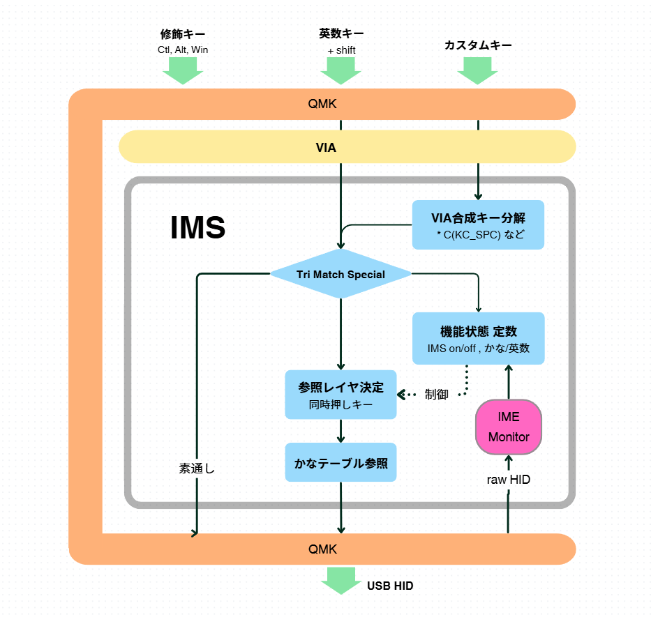

# IMS (Internationalized Multi-Shift) Keyboard
  ver. 2.5 : 2026/10/10 - State machine implementation and process organization
  ver. 2.0 : 2026/07/26 - QMK 0.33.0
  ver. 1.0 : 2026/06/26 - QMK 0.27.0

This is a module for Japanese "Kana" input based on QMK and Via.
It evolves the "Thumb Shift" input environment for natural Japanese typing, while providing a system that allows for free character placement using Via.
By allowing users to freely select and add shift keys to expand input layers, it provides a unique shift input system that is not limited to "Thumb Shift" alone.

## Features

1.  **Reference Language Layers**: Use this module to add reference language layers to English or other language keyboards, allowing you to freely arrange unique language characters.
    (Import custom keycodes into Via)
2.  **Symbol Visibility**: On Japanese layout (JP layout) keyboards, you can input symbols as they appear on English keyboards.
3.  **Shortcut Freedom**: You can freely use shortcut keys (combining English letters and modifier keys) and switch between English/Numbers and Symbol layers even while using a virtual language layer.
4.  **IME Transparency**: When the target language is Japanese, the module passes through the operation keys used by the IME (Input Method Editor). This enables a natural division of labor: the QMK keyboard handles "Kana" (phonetic) input, while the PC-side IME handles "Kana-Kanji" (semantic) conversion, allowing for seamless integration with existing IMEs.
5.  **IME_monitor**: By running `IME_monitor` on the PC side, you can achieve stress-free operation without mode switching errors.

## Characteristics

1.  **Via-based Customization**: Using the Via web interface, users can arrange character keys tailored to their individual needs, regardless of existing layouts.
    (Allows for the development of unique Kana layouts)
2.  **Simultaneous Press Support**: By freely arranging simultaneous press keys, users can substitute other fingers if they experience a thumb injury.
    (Enables the construction of a Japanese input system not limited to thumb shifts)
3.  **Modular Development**: The specific language sections are isolated into `language.c` and its corresponding header files to improve development efficiency.
4.  **Compact Firmware**: As a result of striving for compact firmware, the system was able to compile within the 28kB limit of the ATmega32 microcontroller, even with 43 types of RGB animations.
    (In debug mode, you can temporarily turn off RGB animations to free up 5–6kB of space)

## Other Memorandums regarding Concept and Structure

### 1. Regarding AI Usage

I adhered to the goal of "not writing a single line of code" by utilizing AI.
However, I have reviewed the content according to QMK guidelines and organized/corrected the AI's inference notes within the source code.

### 2. Regarding Structure

The following descriptions apply. Please note that Ⅰ and Ⅲ do not require detailed explanation; Ⅱ is the primary focus.

**Ⅰ. Goals**

- (1) Implementation of a "Thumb Shift" input function independent of the IME.
- (2) Realization of a free and simple key arrangement via the Via interface.

**Ⅱ. Tasks**

- (1) Achieving firmware size that fits on the microcontroller (ATmega32U4).
- (2) Selecting the method for Kana generation.
- (3) Separation of control between Kana generation and function key generation.
- (4) Acquisition and handling of IME states.

**Ⅲ. Side Effects (Achievements)**

- (1) No longer restricted to using only the thumb for simultaneous press keys.
- (2) No limits on the number of input layers or the number of keys per layer when increasing simultaneous press keys.

#### Ⅱ-(1) Firmware size for the microcontroller

For the microcontroller (ATmega32U4), the maximum firmware size for a hex file is around 70KB, but the QMK command indicates the percentage of the 28KB limit consumed.
Specifically, it exceeds 98% and approaches 100%. At first glance, this seems problematic; however, the RGB animations occupy a significant amount of space. Even with 43 animations, they are only played once and quickly forgotten. By cutting them in half, the usage drops to 90%.

#### Ⅱ-(2) Selection of Kana generation method

Given the prerequisite of compactness, the initial strategy suggested by Google Gemini was as follows (it was quite enthusiastic about this, which I've noted is a tendency for AI to favor user-pleasing expressions or forget intentional constraints):

- To ensure compactness, limit functions and perform constant operations. Instead of storing Romanized variables for `SendString`, tap QMK keycodes directly for Kana input. Do not perform Unicode transmission as it requires OS-side setup.
- Avoid QMK functions like `keyOverRide` and minimize `switch-case` statements, opting for fast processing via array matching.

#### Ⅱ-(3) Separation of Kana and Function Key Generation

Initially, Gemini struggled with layer up/down operations during Kana input, leading to long deliberations and repeated errors. I eventually instructed it to change the policy entirely: since the purpose of Via is web-based table operation, the reference layer should be fixed.

Regarding the creation of custom keycodes, I discovered that Gemini would not search for the custom start values for Via's `SAFE_RANGE` on its own unless provided with web information (<https://github.com/qmk/qmk_firmware/pull/19916>). Without this, Gemini would try to have me confirm the difference values and then hardcode them. By providing that specific information, Gemini successfully built a system for per-layer key position references and Kana searching.

However, when it came to modifier decomposition and control stages, it began to lose its way again—repeating the same errors, bringing back forbidden 16-bit hex hardcoding under different names, and behaving like a talented but frustrated intern. I even questioned if the $2 Gemini Plus was sufficient.

Eventually, I switched to Claude Pro ($20/month) and proceeded more smoothly, though I still encountered repeated errors that nearly stalled the firmware. I considered whether I needed to manually check the code, but I found a function called `Tri_Match_Special` (which seems to be a bitwise operation for modifier accumulation/subtraction) and felt it would be too taxing to trace.

I was shocked to find that the code was tapping 16-bit values for modifiers and characters separately in another location. Since there is no press/release "catch" for individual consecutive taps, this is meaningless. This is the part where QMK should be receiving composite keys from Via and sending them to USB with the correct press/release order.

In the end, Version 1 was completed in the conceptual form shown in the diagram below, but I am left wondering what that process was all about. It seems that for Via's unique `SAFE_RANGE` types of information, one must either broaden the scope of information or prompt the AI to delve deeper into the inference of the code logic.

#### Ⅱ-(4) Acquisition and Handling of IME State

I had the logic for obtaining the IME state from external software created based on existing materials. Rather than setting up a Python script environment, I used Rust.
However, since I believe that switching between full-width/half-width and Kana/Kana-Kanji can be handled by the "Henkan" key, and half-width English can be handled by turning off the IME, I only use information regarding whether the IME is in "English/Numbers" or "Kana" mode (I do not implement character type selection).

## (Reference 1) Effective Prompting Methods for Anthropic Claude

**1. Force a "Redefinition of Overall Design"**

Do not let the AI just fix fragments of code; first, make it acknowledge the "limits of the current design" and have it redraw the overall picture.

Example:
> "The current correction loop may have a fundamental design flaw. Forget the previous code for a moment and propose the optimal data structure and algorithm to meet the current requirements. Present the design plan as a bulleted list."

**2. Have it Compare "Multiple Approaches"**

Instead of asking for one correct answer, give it options to broaden its perspective.

Example:
> "To resolve the current error, please propose three different approaches (e.g., library change, architecture refresh, processing simplification). Compare the pros and cons of each and tell me which is the most robust method."

**3. Insert a "Critical Review" Phase**

Clearly separate the roles of the "Coder" and the "Reviewer."

Example:
> "You are now a world-class senior engineer and code reviewer. Critically review the proposed code from the perspectives of 'extensibility,' 'maintainability,' and 'edge-case handling.' List the improvements needed, then provide the complete code reflecting those improvements."

**4. Reset Context and Provide "Requirements" Only (The Ultimate Measure)**

If the chat becomes too long, the AI may get pulled into its past mistakes. Starting a new chat and providing the following is the most reliable method.

Example:
> "[Current Specifications/Requirements] I want to implement this, but the previous method ([Summary of failed code]) resulted in [Specific Error]. Based on this failure, propose a completely different implementation strategy that avoids the same pitfalls and create the code."

## (Reference 2) AI Perspective on Internationalization

When I tried to incorporate an "Internationalization" perspective to break the limitations of Thumb Shift, the AI immediately denied it with the following explanation:

> Attempting to introduce "Thumb Shift (simultaneous press)" for composite characters in Asian languages may have an explosive effect if limited to "specific high-frequency syllables," but it faces challenges in covering the entire language.
> The boundary between useful cases and practical limits for one-shot shortcuts is as follows:

**1. Useful Cases: Double Symbols in Vietnamese or Thai**

Vietnamese has many characters with overlapping vowels and diacritics (e.g., ế, ộ).

- Current: Requires 3–4 keystrokes (e.g., e + e + f).
- Thumb Shift: If "e" + "Thumb" can produce ế in one stroke, input efficiency improves dramatically.

This is very similar to the sensation of producing "Dakuon" (voiced sounds) in one stroke in Japanese.

**2. Useless Cases: Hangul (Korean)**

Hangul has over 10,000 combinations of initial, medial, and final consonants. Attempting to define a "completed character" via simultaneous press would require thousands of keys.
The conclusion is that for Hangul, "tapping parts (Jamo) at high speed" consumes less brain memory and is ultimately faster.

**3. Demand for "Word Shortcuts"**

In Asian languages (especially Chinese and Thai), an approach similar to shorthand (stenography)—where frequently used words or particles are output via simultaneous press—could be very useful.
For example, assigning frequently occurring parts in Chinese (like "の" / "的") or polite endings in Thai to thumb simultaneous presses.

